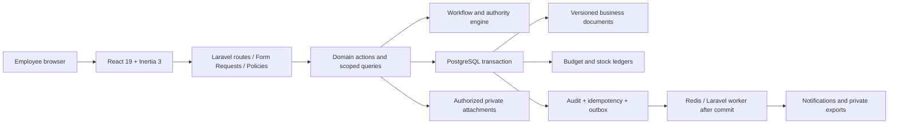

# ADR-001: Modular Laravel monolith with transactional ledgers

**Status:** Proposed architecture based on the requested stack; foundation implementation proceeds incrementally.

**Date:** 2026-10-15 (Asia/Manila)

**Deciders:** Organization process owner and implementation team. Fiscal/accounting policy choices remain configurable and require business confirmation before live use.

## Context

StockNest joins annual planning, spending authority, department requests, purchasing, physical stock, and monthly counts. These processes share strong consistency requirements. A request must not change stock when approved; receipt and spending must remain distinct; two simultaneous issuances must not spend the same last unit. The initial organization is small to medium, with two user-confirmed funds, GAA and APPCSE.

The requested stack is PHP 8.4 or later compatible with Laravel 13, React 19/TypeScript, Inertia 3, Tailwind 4/shadcn/ui, PostgreSQL 18, and Redis. Use the official Laravel React starter where compatible and retain its authentication/security conventions. Resolve stable compatible versions and lock them; do not assume a requested major version guarantees every optional package supports it.

## Decision

Use one deployable Laravel application and one PostgreSQL database with cohesive domain modules. React/Inertia delivers server-authorized pages from the same application. Use PostgreSQL transactions for financial and stock consistency. Add Redis queues/cache for asynchronous work; a queue job is never the sole protection for an integrity constraint. Keep ledger writes, balance updates, audit, and idempotency atomic in the command transaction; dispatch external notifications/exports only after commit using a transactional outbox where delivery guarantees matter.

| Area | Choice and purpose |
|---|---|
| HTTP boundary | Thin Laravel controllers + Form Requests + Policies; no business rules embedded in React |
| Application logic | Single-purpose actions/services for submit, decide, approve order, receive, reserve, issue, post expenditure, reconcile count |
| Persistence | Eloquent aggregates and explicit repository/query objects when useful; constraints and row locks as final integrity boundary |
| Read models | Scoped queries for dashboard/reports; stock/budget summaries reconcile to authoritative ledgers |
| Approvals | Versioned workflow definitions and immutable run/decision records; server-enforced sequence and authority |
| Stock | Append-only movements with signed position entries; locked materialized balances for fast availability |
| Finance | Append-only budget/commitment/expenditure entries and explicit allocation links |
| Documents | Private storage, metadata and authorization; malware quarantine when available; authenticated downloads |
| Notifications | Laravel notifications/events with queued delivery after commit; configurable email provider |
| Spreadsheets | Laravel Excel after compatibility verification; queued bounded import/export with validation preview |
| PDF | Select maintained library after checking Laravel 13/PHP compatibility; headless rendering must sandbox untrusted HTML and remote resource access |
| Analytics | Recharts from real scoped queries; no seeded/demo numbers in production dashboard |
| Tests | Pest backend; Vitest component/formatting behavior; Playwright integrated workflows; PostgreSQL concurrency tests |

## Alternatives considered

| Option | Complexity | Operating cost | Consistency | Fit |
|---|---|---|---|---|
| Modular monolith (selected) | Moderate, clear boundaries | One app + database + optional Redis workers | One atomic database transaction | Practical for initial scale and team |
| Microservices per module | High; deployment and distributed contracts | Multiple services, transport, tracing, recovery | Distributed settlement/reconciliation needed | Adds failure modes without demonstrated scale need |
| Independent SPA and public API first | Moderate/high; separate auth and deployment | Separate frontend delivery | Still possible, more duplicate validation/contract work | Less practical than requested Inertia integration initially |
| Generic inventory CRUD | Low initially | Low initially | Mutable balances and missing financial states | Cannot satisfy traceability or approval rules |

## Component and data flow



## Transaction pattern

1. Authenticate; validate with Form Request; authorize action and scope; reject closed period or invalid transition.
2. Begin database transaction; acquire idempotency record scoped to actor/operation and validate payload hash.
3. Lock aggregate and dependent rows in stable order (for stock: fund, item, location, lot; for budget: fiscal year, fund). Re-read state and authority-sensitive inputs.
4. Recalculate using exact decimal arithmetic or integer minor-unit arithmetic at documented precision. Validate outstanding authorized quantities, balances, reservations, and budget under lock.
5. Persist new document state, immutable ledger entries, projection balances, audit and outbox. Unique source-posting constraints stop duplicate postings independently of the idempotency cache.
6. Commit; return prior result for retries; deliver notifications asynchronously after commit. Retry serialization/deadlock conflicts a bounded number of times using the same idempotency key.

For a PO, budget lock and commitment posting happen together. For an expenditure, spend and matching commitment settlement happen together. For a transfer, source/destination ledger entries balance within one transaction. Reversal creates new linked entries; it never edits the original posting. External email failures do not roll back valid stock or expense postings.

## Planned folder structure

```text
app/
  Actions/                  # Business commands grouped by domain
    Access/ Approvals/ Budget/ Catalog/ Requests/
    Procurement/ Inventory/ Counts/ Reporting/ FiscalYears/
  Domain/                   # Domain enums, value objects, invariants where useful
  Events/                   # Facts emitted after successful transitions
  Http/Controllers/         # Inertia page/query and action endpoints
  Http/Requests/             # Server input validation
  Jobs/                     # Imports, exports, outbox, notifications
  Models/                   # Eloquent relationships and casts
  Notifications/
  Policies/                 # Permission + object/scope/state checks
  Queries/                  # Scoped reports, dashboard, lookup queries
  Services/                 # Shared decimal, numbering, audit, attachment helpers
database/
  migrations/ factories/ seeders/
resources/js/
  components/               # shadcn primitives and reusable domain components
  layouts/ pages/ hooks/ types/ lib/
routes/                     # web/auth/settings, grouped domain routes when needed
tests/
  Unit/ Feature/ Browser/   # Browser tests may also live in Playwright test directory
docs/                       # Design, operations and user guidance
.planning/                  # Roadmap and implementation status
docker/                     # App, web, worker and database support configuration
```

These are boundary guidelines, not a mandate to create empty abstractions. Keep starter-kit conventions where they already supply appropriate structure. Extract domain namespaces when code volume warrants it. Single-purpose command classes make cross-module transactional logic testable without introducing microservices or an unnecessary generic repository framework.

## Security and operations

- Laravel session authentication, CSRF, secure cookies, password hashing, reset throttling and optional 2FA; deactivate accounts and invalidate sessions through authorized actions.
- Policies and scoped queries on every document, list, metric, lookup, attachment and export. Do not broadly bypass policy checks for administrative roles.
- Private file storage; type/extension/content and size checks; random storage names; scan/quarantine where available; do not render uploaded HTML as trusted content.
- Least-privilege database roles, HTTPS, secrets outside Git, `APP_DEBUG=false` in production, exception redaction, queue failure monitoring, and log access control.
- Audit action, actor, effective scopes, target revision, before/after fields as appropriate, reason, UTC timestamp and request correlation; omit passwords/tokens/session secrets.
- Application workers must not alter/delete posted ledger/audit rows. Use database permissions/triggers or a carefully tested posting boundary with append-only roles where feasible; do not rely on frontend immutability.
- Backups cover PostgreSQL, private files, and encryption key recovery. Restore drills and reconciliation matter more than a successful backup job message.

## Consequences

The application gains atomic budget and stock operations and straightforward local deployment. A single database is a shared availability boundary, so backup/restore, monitoring, bounded jobs, indexing and connection management are necessary. Cross-module commands must remain explicit and tested to prevent an unstructured monolith. Background queues add operations work but keep imports/exports and delivery away from interactive transactions.

## Action items

- [ ] Confirm approval authority, fiscal calendar, costing/rounding and expenditure recognition policy.
- [ ] Resolve and lock compatible framework and optional package versions; document exceptions.
- [ ] Build access/scoping, workflows and audit before posting commands.
- [ ] Implement database constraints, atomic budget/stock actions and idempotency.
- [ ] Run acceptance, authorization and real PostgreSQL concurrency verification.
- [ ] Complete deployment, backup restore and business acceptance before production use.
