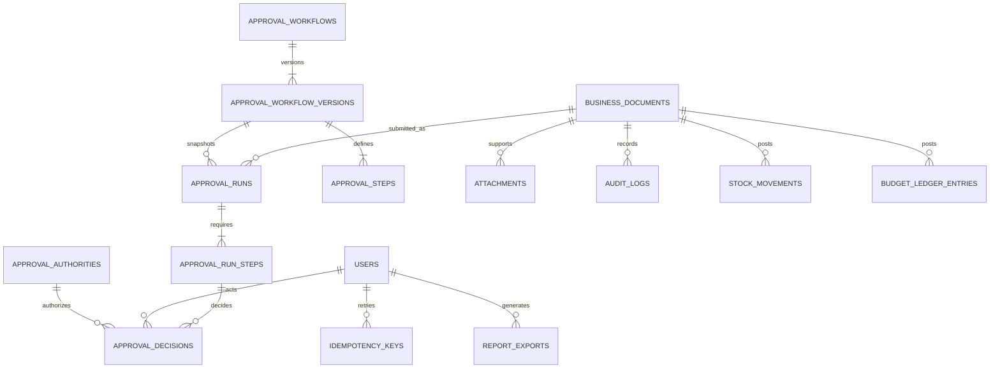

# Proposed database schema and ER diagram

**Status:** Target design for phased implementation. The tables below are not a migration inventory; inspect `database/migrations/` for what exists. Names can be adapted to consistent Laravel conventions while preserving these relationships and controls.

## Shared conventions

- PostgreSQL 18; generated `bigint` identities internally and optional public UUID/ULID references. Never rely on identifier unpredictability for access control.
- `timestamptz` timestamps stored as UTC; fiscal dates are explicit `date` values. Organization timezone converts display and cutoff input.
- Quantities `numeric(18,4)` and monetary values `numeric(20,4)`; no floating-point arithmetic. Store currency code on each budget account and financial document. A single configured PHP base currency initially avoids silent exchange-rate assumptions.
- Master records deactivate instead of disappearing from historical transactions. Posted documents, approval decisions, ledger entries, snapshots and audit events are immutable. Corrections use linked revisions/reversals.
- Positive quantities/prices on ordinary business lines; signed deltas only on controlled ledger/adjustment entries. Check constraints reject negative or zero values as appropriate; quantities may be zero in draft/count snapshots.
- Required foreign keys with restrictive delete behavior for referenced history. Cascading deletion only for unsubmitted draft children under explicit policy; archived documents remain queryable.
- Business document registry: `business_documents(id, document_type, reference, created_by, created_at)` provides a real FK target for approvals, attachments, and ledger source links. Domain headers use `document_id` as unique FK/identity; do not use unconstrained `source_type/source_id` pairs as the only posting reference. Enforce each header's expected document type through a checked discriminator/composite FK or equivalent tested integrity mechanism.
- Snapshot descriptive business fields needed on approved/posted documents (SKU, description/specification, UOM, price, supplier details) preserve meaning when master data changes; item/master FKs still permit traceability.
- Multiple departments/funds can use one catalog item. Fund ownership belongs to financial documents and inventory positions, not to the shared item master.

## Organization, identity and approval

| Tables                                                               | Key fields, relationships and constraints                                                                                                                                                                       |
| -------------------------------------------------------------------- | --------------------------------------------------------------------------------------------------------------------------------------------------------------------------------------------------------------- |
| `organizations`, `system_settings`                                   | Organization name, currency, timezone; typed settings with unique key and version/effective period where behavior changes. Treat secrets as environment/provider configuration, not ordinary readable settings. |
| `users`, `departments`                                               | Unique normalized email; password hash, active flag, verified/2FA fields; department code unique; account deactivation preserves actor references.                                                              |
| Spatie `roles`, `permissions`, pivots                                | Package migrations and guard-compatible roles/permissions. Unique permission and role identifiers per guard.                                                                                                    |
| `user_department_scopes`, `user_funding_source_scopes`               | User, target department/fund, visibility/operation scope, starts/ends, granting actor and reason. Prevent duplicate overlapping equivalent active grants.                                                       |
| `funding_sources`                                                    | Unique code; name initially GAA/APPCSE, active flag, accounting reference, configured budget enforcement. Referenced funds cannot be deleted.                                                                   |
| `fiscal_years`, `fiscal_periods`                                     | Code, opening/closing dates, status, closing/reopening actor and reason; start ≤ end. Nonoverlapping fiscal-year date ranges; unique month/period within year.                                                  |
| `approval_workflows`, `approval_workflow_versions`, `approval_steps` | Type and scope routing; immutable published version; ordered steps, required permission/role, limits, exception conditions, active dates. Unique sequence per version.                                          |
| `approval_authorities`, `approval_delegations`                       | Person/role, fund, department, document type, amount limit, effective dates, delegator/granter/reason; no silent delegation to submitter.                                                                       |
| `approval_runs`, `approval_run_steps`                                | Document FK, revision, workflow version, submitter, submitted amount/basis; immutable step snapshot and assigned authority; one active run per document revision.                                               |
| `approval_decisions`                                                 | Run-step, deciding user, decision, comments, effective authority/delegation reference and timestamp; unique final decision slot; never update an existing decision to alter history.                            |
| `business_documents`                                                 | Type, unique reference, creator; common FK identity for lifecycle records. Actual state, revision, fund and fiscal dimensions reside on typed domain headers.                                                   |

Optional approval step parallelism/quorum must be explicit; initial ordered all-required steps avoid ambiguous completion. A return ends its current run; revision/resubmission creates a new run.

## Catalog and suppliers

| Tables                                | Key fields and rules                                                                                                                                                                                                                                                           |
| ------------------------------------- | ------------------------------------------------------------------------------------------------------------------------------------------------------------------------------------------------------------------------------------------------------------------------------ |
| `item_categories`, `units_of_measure` | Unique code/name; active flag; UOM precision/whole-unit rule. Unit conversion is not implicit.                                                                                                                                                                                 |
| `items`                               | Unique normalized SKU, name, category/UOM FKs, description/specification, type, standard estimated cost, min/reorder/max, active flag, optional image/barcode; thresholds nonnegative and coherent. Expiration belongs to lot records, not a single item-wide expiration date. |
| `suppliers`, `supplier_contacts`      | Unique supplier code, legal/contact/accounting details, active flag; protect sensitive payment information through separate permission.                                                                                                                                        |
| `item_supplier_preferences`           | Item + supplier unique, supplier item code, preference rank and indicative price; supplier quotes do not rewrite historical PO prices.                                                                                                                                         |
| `warehouses`, `stock_locations`       | Unique warehouse/location codes, parent warehouse FK, active flag, optional counting zone. Item default location is a preference, not its stock balance.                                                                                                                       |
| `item_location_thresholds`            | Optional item/location-specific reorder/min/max values; unique item/location; fund-specific threshold only when explicitly configured.                                                                                                                                         |

## Planning and budget

| Tables                                                | Key fields and rules                                                                                                                                                                                                                              |
| ----------------------------------------------------- | ------------------------------------------------------------------------------------------------------------------------------------------------------------------------------------------------------------------------------------------------- |
| `annual_projections`                                  | Document, year, fund, department, state, original approved version, current approved version; unique year/fund/department logical plan. Version pointers must refer to versions of this plan.                                                     |
| `projection_versions`                                 | Projection FK, sequence, base version, draft/submitted/approved status, submitted/approved actors and timestamps; unique projection/sequence; approved version immutable.                                                                         |
| `projection_items`                                    | Version FK, stable logical line UUID, item/UOM references and description snapshot, quantity, unit estimate, justification, priority, remarks. One line identity per version; exact computed line total.                                          |
| `projection_item_months`                              | Projection item + fiscal period unique; monthly quantity, optional intended amount; breakdown totals validated against annual amount/quantity according to declared rounding rule.                                                                |
| `projection_amendments`, `projection_amendment_lines` | Document, target plan, base version, proposed version, reason, state, changed logical line and old/new terms. Approval advances current version only; original remains fixed.                                                                     |
| `budget_accounts`                                     | Unique fiscal year/fund/currency, enforcement mode; authoritative account for allocation, commitment and spend. Optional departmental limits are sublimits, not duplicate funds.                                                                  |
| `budget_allocations`, `budget_allocation_lines`       | Document, account, authorization reference/approval, posted date; signed line adjustments only in explicit adjustment/reversal documents. Projection approval does not implicitly populate these.                                                 |
| `budget_adjustments`, `budget_adjustment_lines`       | Document, source authorization, reason, account and authorized delta; approval/reversal retains original events. Transfers require explicit paired authorization, not a disguised edit.                                                           |
| `financial_commitments`, `commitment_lines`           | Approved PO and revision, account, PO line and amount, authorized increases/releases; unique posting source. Commitment header identifies obligation; the ledger records its amount changes.                                                      |
| `expenditure_records`, `expenditure_lines`            | Document, account, payee/supplier, recognition date, payment/accounting reference, state, approval, amount; only posted records count as actual expenditure. Explicit recognized paid basis is initial default.                                   |
| `expenditure_allocations`                             | Expenditure line → PO/commitment line, recognized quantity or allocated amount and settlement basis. Supports partial payment and prevents over-settlement. Unlinked expenditure requires its own authorized category/reason.                     |
| `budget_ledger_entries`                               | Account, bucket (`authorized`, `committed`, `actual`), signed amount, source document + line + posting kind, commitment/expenditure allocation where relevant, reversal FK, posted actor/time. Unique source/kind/line prevents repeated posting. |
| `budget_balances`                                     | One row per account with authorized/committed/actual totals and lock version; materialized projection only, rebuilt/reconciled from ledger.                                                                                                       |

`budget_ledger_entries` is the amount authority. Document amounts are the approved source terms. Avoid adding both a document total and its ledger posting when reporting. `available = authorized − committed − actual`; settlement creates a committed decrease and actual increase in the same transaction. Overpayment, price increases and cancellation each need an explicitly authorized event; no negative outstanding commitment.

## Requests, procurement and receipt

| Tables                                                      | Key fields and rules                                                                                                                                                                                                                                 |
| ----------------------------------------------------------- | ---------------------------------------------------------------------------------------------------------------------------------------------------------------------------------------------------------------------------------------------------- |
| `item_requests`, `item_request_revisions`                   | Document, year/fund/department, requester, required date, priority, purpose, state and current revision. Revisions preserve submitted/approved content. Unique request reference; cancellation reason and authority.                                 |
| `item_request_lines`                                        | Revision + logical line, item/UOM, requested quantity, proposed unit price, approved quantity, projection-line link when planned, unplanned flag/reason. Approved quantity ≤ requested unless an approved revised request explicitly changes demand. |
| `request_change_requests`, `request_change_lines`           | Target approved revision, proposed differences, reason, state and approval; cannot lower authorization below already net fulfilled or committed portions without resolving them.                                                                     |
| `procurement_requisitions`, `procurement_requisition_lines` | Document, source approved request lines and unmet quantities, procurement review state. A separate step from departmental request and physical issuance.                                                                                             |
| `purchase_orders`, `purchase_order_revisions`               | Document, fund/year/account, supplier, state, order/delivery dates, terms, currency, totals, revision and approval. One fund per order initially.                                                                                                    |
| `purchase_order_lines`                                      | Revision, item/UOM snapshots, ordered quantity, price, tax/discount/charges allocated under explicit rounding rules.                                                                                                                                 |
| `purchase_order_request_allocations`                        | PO line → approved request line with authorized quantity/amount. Many request lines can aggregate into one order line; fund/item/UOM must agree. Prevent oversourcing the same approved requirement.                                                 |
| `goods_receipts`, `goods_receipt_lines`                     | Document, PO/revision, receiving actor/time, supplier delivery reference, destination, accepted/rejected quantities; lines link exact PO lines. Unique supplier delivery reference where appropriate. Only accepted quantities post stock.           |
| `supplier_returns`, `supplier_return_lines`                 | Document, original receipt/lot, returned quantity, reason, approval, credit/refund reference if known; physical return and financial refund remain separate events.                                                                                  |

Use source allocations instead of assuming one request maps to one PO or one receipt. Outstanding delivery derives from approved ordered quantity minus accepted receipts plus eligible linked returns, under an explicit replacement/cancellation rule. Supplier over-delivery requires amendment/approval before it can post as accepted stock.

## Inventory, fulfillment and counts

| Tables                                                | Key fields and rules                                                                                                                                                                                                                                                   |
| ----------------------------------------------------- | ---------------------------------------------------------------------------------------------------------------------------------------------------------------------------------------------------------------------------------------------------------------------- |
| `stock_lots`                                          | Item, lot/batch reference, expiration, supplier/receipt provenance; no-lot items use explicit untracked identity instead of accidental NULL duplicate balances.                                                                                                        |
| `inventory_positions`                                 | Item, fund owner, location, normalized lot key, unit, optional quality condition; unique position key. PostgreSQL `UNIQUE NULLS NOT DISTINCT` or nonnullable lot key closes NULL uniqueness gaps.                                                                      |
| `stock_balances`                                      | Unique position; on-hand, reserved, lock version; checks `on_hand >= 0`, `reserved >= 0`, `reserved <= on_hand`. Derived from ledger and active reservation allocations.                                                                                               |
| `stock_movements`, `stock_movement_entries`           | Movement document, type, effective time, posting time, actor, reason/source; entries position + signed quantity + cost/value snapshot. Unique source line/posting kind; entries never edited. Transfer entries sum to zero for quantity/value and keep fund ownership. |
| `stock_reservations`, `stock_reservation_lines`       | Approved request line, position, quantity, expires/status, consumed/released quantity; active remainder cannot exceed approved outstanding demand or position availability.                                                                                            |
| `stock_issuances`, `stock_issuance_lines`             | Document, approved request/revision, issuer, recipient, acknowledgment/date, state; lines quantity, position and reservation allocation. Confirm once; draft/pick does not post.                                                                                       |
| `stock_returns`, `stock_return_lines`                 | Document, original issuance line, accepted quantity/condition, returning/receiving actors; cannot return more than issued less prior accepted returns.                                                                                                                 |
| `stock_transfers`, `stock_transfer_lines`             | Document, source/destination, owned positions, quantities, approvals; atomic same-fund movement initially. Any in-transit process needs its own explicit location/state, never stock disappearance.                                                                    |
| `inventory_counts`, `inventory_count_assignments`     | Document, month, warehouse/zone, cutoff instant/ledger sequence, state, assigned counters/reviewers. Prevent competing unreconciled sessions for overlapping scope/cutoff.                                                                                             |
| `inventory_count_lines`                               | Session + position unique, immutable cutoff quantity, final accepted physical quantity, computed variance, reason; zero-system positions can be explicitly added with provenance.                                                                                      |
| `inventory_count_observations`                        | Count line, count/recount number, counter, observed time, observed physical quantity, movement reconciliation, remarks; preserve earlier counts rather than overwrite them.                                                                                            |
| `inventory_adjustments`, `inventory_adjustment_lines` | Document, count line or other authorized cause, signed variance, approval, reason, source movement, reversal; unique count line posting prevents double reconciliation.                                                                                                |

Counts snapshot ledger position quantities at cutoff. Reconciliation adds the approved variance to current stock; it does not overwrite current stock with a historical count. Ledger effective/posting times and cutoff sequence distinguish backdated entries from transactions present in the snapshot. Prohibit ordinary backdating into an active/final count cutoff; any authorized correction invalidates/reviews the affected snapshot with audit evidence.

Valuation entries capture explicit cost basis and quantity/value deltas. Do not infer financial expenditure from inventory valuation. A movement funded by GAA cannot consume APPCSE ownership. Organization-wide physical totals sum distinct positions once.

## System support

| Tables                                            | Key fields and rules                                                                                                                                                                                          |
| ------------------------------------------------- | ------------------------------------------------------------------------------------------------------------------------------------------------------------------------------------------------------------- |
| `attachments`                                     | Document FK, private storage key, original filename, detected MIME, bytes, checksum, uploader, scan status; authorization through parent and file policy.                                                     |
| `notifications`, `notification_preferences`       | Laravel notification records; per-user channel/type preferences; document links never bypass target authorization.                                                                                            |
| `audit_logs`, `login_activity`                    | Actor/service identity, action, target document or typed immutable target snapshot, revision, timestamp, correlation, appropriate before/after/reason; redact secrets. No application edit/delete operations. |
| `idempotency_keys`                                | User/tenant-operation scope, key unique, payload hash, in-progress/completed status, result document/response and expiry; database uniqueness, not cache-only lock.                                           |
| `outbox_messages`                                 | Event key unique, aggregate/revision, payload, attempts, next attempt and delivered state; worker sends after committed transaction.                                                                          |
| `report_exports`, `import_batches`, `import_rows` | Owner, scoped filters, status, validation errors, private artifact key, expiry; reauthorize download and re-check scope before queued generation. Imports stage/validate before domain actions.               |
| `fiscal_close_runs`, `fiscal_close_checks`        | Year, initiator, reconciliation results, unresolved documents, approval and close snapshot; reopening records a distinct authorized event.                                                                    |

Do not store passwords, reset tokens, 2FA secrets, unrestricted attachment contents, or session secrets inside audit before/after JSON.

## ERD: core traceability

```mermaid
erDiagram
    USERS ||--o{ USER_DEPARTMENT_SCOPES : has
    DEPARTMENTS ||--o{ USER_DEPARTMENT_SCOPES : grants
    USERS ||--o{ USER_FUND_SCOPES : has
    FUNDING_SOURCES ||--o{ USER_FUND_SCOPES : grants
    FUNDING_SOURCES ||--o{ ANNUAL_PROJECTIONS : plans
    FISCAL_YEARS ||--o{ ANNUAL_PROJECTIONS : contains
    DEPARTMENTS ||--o{ ANNUAL_PROJECTIONS : prepares
    ANNUAL_PROJECTIONS ||--|{ PROJECTION_VERSIONS : versions
    PROJECTION_VERSIONS ||--o{ PROJECTION_ITEMS : contains
    PROJECTION_ITEMS ||--o{ PROJECTION_ITEM_MONTHS : schedules
    ITEMS ||--o{ PROJECTION_ITEMS : estimates
    ANNUAL_PROJECTIONS ||--o{ PROJECTION_AMENDMENTS : revises
    FUNDING_SOURCES ||--o{ BUDGET_ACCOUNTS : owns
    FISCAL_YEARS ||--o{ BUDGET_ACCOUNTS : partitions
    BUDGET_ACCOUNTS ||--o{ BUDGET_LEDGER_ENTRIES : posts
    BUDGET_ACCOUNTS ||--o{ BUDGET_ALLOCATIONS : authorizes
    BUDGET_ACCOUNTS ||--o{ FINANCIAL_COMMITMENTS : commits
    BUDGET_ACCOUNTS ||--o{ EXPENDITURE_RECORDS : spends
    FUNDING_SOURCES ||--o{ ITEM_REQUESTS : funds
    DEPARTMENTS ||--o{ ITEM_REQUESTS : submits
    USERS ||--o{ ITEM_REQUESTS : requests
    ITEM_REQUESTS ||--|{ ITEM_REQUEST_REVISIONS : preserves
    ITEM_REQUEST_REVISIONS ||--|{ ITEM_REQUEST_LINES : contains
    ITEMS ||--o{ ITEM_REQUEST_LINES : requested
    PROJECTION_ITEMS o|--o{ ITEM_REQUEST_LINES : optionally_plans
    ITEM_REQUEST_LINES ||--o{ PROCUREMENT_REQUISITION_LINES : requires
    PROCUREMENT_REQUISITIONS ||--|{ PROCUREMENT_REQUISITION_LINES : contains
    SUPPLIERS ||--o{ PURCHASE_ORDERS : supplies
    PURCHASE_ORDERS ||--|{ PURCHASE_ORDER_LINES : contains
    PURCHASE_ORDER_LINES ||--o{ PO_REQUEST_ALLOCATIONS : sources
    ITEM_REQUEST_LINES ||--o{ PO_REQUEST_ALLOCATIONS : fulfills
    PURCHASE_ORDERS ||--o{ FINANCIAL_COMMITMENTS : authorizes
    FINANCIAL_COMMITMENTS ||--|{ COMMITMENT_LINES : contains
    PURCHASE_ORDER_LINES ||--o{ GOODS_RECEIPT_LINES : delivered
    GOODS_RECEIPTS ||--|{ GOODS_RECEIPT_LINES : contains
    EXPENDITURE_RECORDS ||--|{ EXPENDITURE_LINES : contains
    EXPENDITURE_LINES ||--o{ EXPENDITURE_ALLOCATIONS : allocates
    COMMITMENT_LINES ||--o{ EXPENDITURE_ALLOCATIONS : settles
    ITEMS ||--o{ INVENTORY_POSITIONS : stocked
    FUNDING_SOURCES ||--o{ INVENTORY_POSITIONS : owns
    STOCK_LOCATIONS ||--o{ INVENTORY_POSITIONS : holds
    STOCK_LOTS o|--o{ INVENTORY_POSITIONS : identifies
    INVENTORY_POSITIONS ||--|| STOCK_BALANCES : projects
    STOCK_MOVEMENTS ||--|{ STOCK_MOVEMENT_ENTRIES : posts
    INVENTORY_POSITIONS ||--o{ STOCK_MOVEMENT_ENTRIES : changes
    ITEM_REQUEST_LINES ||--o{ STOCK_RESERVATION_LINES : reserves
    INVENTORY_POSITIONS ||--o{ STOCK_RESERVATION_LINES : allocates
    STOCK_ISSUANCES ||--|{ STOCK_ISSUANCE_LINES : releases
    ITEM_REQUEST_LINES ||--o{ STOCK_ISSUANCE_LINES : fulfills
    INVENTORY_POSITIONS ||--o{ STOCK_ISSUANCE_LINES : deducts
    INVENTORY_COUNTS ||--|{ INVENTORY_COUNT_LINES : snapshots
    INVENTORY_POSITIONS ||--o{ INVENTORY_COUNT_LINES : counts
    INVENTORY_COUNT_LINES ||--o{ INVENTORY_COUNT_OBSERVATIONS : recounts
    INVENTORY_COUNT_LINES o|--o| INVENTORY_ADJUSTMENT_LINES : reconciles
    INVENTORY_ADJUSTMENTS ||--|{ INVENTORY_ADJUSTMENT_LINES : authorizes
```

## ERD: workflow and document infrastructure

## Required indexes and integrity checks

- Unique document reference, case-normalized item/fund/department codes and emails, version numbers, source posting identifiers, and idempotency scope/key.
- All foreign keys indexed where needed by joins/lock lookups; header indexes `(funding_source_id, fiscal_year_id, status, created_at)` and `(department_id, status, requester_id)` support scoped queues.
- Approval inbox `(assigned_user_id, status, sequence)` and fund/role assignment indexes; notifications `(notifiable_id, read_at, created_at)`.
- Stock unique position key; entries `(position_id, posted_at, id)` and `(movement_id)`; reservations `(position_id, status)` and `(request_line_id)`; lots expiration index for active stock.
- Budget entries `(account_id, bucket, posted_at, id)`, commitment source and expenditure reference indexes; balances lock by account PK.
- Count session/position unique, adjustment count-line unique, count cutoff/effective-time indexes; invoice/payment duplicate checks use supplier+reference+fiscal/account context rather than globally blocking unrelated suppliers' references.
- Application commands enforce cross-row sums/authorization under transaction locks; SQL checks/FKs/unique indexes enforce per-row invariants. Consider deferred constraint triggers for balance/ledger pair validation where clear and tested. Do not use a check constraint that silently assumes access to mutable rows in another table.
- Validate ledger → balance reconciliation, financial settlement → remaining commitment, receipt → outstanding order, and issuance → approved outstanding request in automated tests and periodic diagnostics.

## Migration and seed strategy

Create access/master tables first, then workflow/audit infrastructure, planning/budget, requisitions/procurement, ledger/fulfillment, counts, reporting and closing. Keep irreversible posted-data migrations separate from ordinary schema migration; backup and rehearse before changing ledger precision or enum semantics.

Production seeders create stable permission identifiers, nine role bundles, configured defaults and funding sources **GAA/APPCSE** idempotently. They do not silently overwrite live grants or accounting controls. Never commit a default administrator password. Initial administrator provisioning uses an explicit local/operator action.

Demo seeders are opt-in and prohibited in production. They create a clearly labeled demo fiscal year, separate example projections by fund, requests/approvals and source-linked sample transactions through real domain actions. Demo data must be removable by recreating a disposable development database, not by deleting real ledger rows.
