# Implemented schema

This describes the checked-in migrations; [the full proposed schema](database-design.md) is broader. Documents and physical balances carry fund attribution while items are shared.

The October 17 audit migrations add `users.must_change_password` (default false for existing accounts) and nullable `stock_transfers.effective_on` (preserving historical transfers). Newly administrator-created accounts must replace their initial password. New transfers persist their effective date and validate it against the selected open fiscal year. The same upgrade adds explicit approval/reopening permissions without replacing existing customized role grants.

```mermaid
erDiagram
    DEPARTMENTS ||--o{ USERS : assigns
    USERS ||--o{ FUNDING_SOURCE_USER : receives
    FUNDING_SOURCES ||--o{ FUNDING_SOURCE_USER : grants
    FUNDING_SOURCES ||--o{ BUDGET_ALLOCATIONS : owns
    FISCAL_YEARS ||--o{ BUDGET_ALLOCATIONS : authorizes
    BUDGET_ALLOCATIONS ||--o{ BUDGET_ADJUSTMENTS : changes
    FUNDING_SOURCES ||--o{ ANNUAL_PROJECTIONS : plans
    ANNUAL_PROJECTIONS o|--o{ ANNUAL_PROJECTIONS : retains_revisions
    ANNUAL_PROJECTIONS ||--|{ PROJECTION_LINES : contains
    ITEMS ||--o{ PROJECTION_LINES : estimates
    ITEM_CATEGORIES ||--o{ ITEMS : groups
    UNITS_OF_MEASURE ||--o{ ITEMS : measures
    SUPPLIERS o|--o{ ITEMS : preferred
    DEPARTMENTS ||--o{ ITEM_REQUESTS : requests
    FUNDING_SOURCES ||--o{ ITEM_REQUESTS : funds
    ITEM_REQUESTS ||--|{ ITEM_REQUEST_LINES : contains
    ITEMS ||--o{ ITEM_REQUEST_LINES : requests
    ITEM_REQUESTS ||--o{ PURCHASE_ORDERS : procures
    SUPPLIERS ||--o{ PURCHASE_ORDERS : supplies
    PURCHASE_ORDERS ||--|{ PURCHASE_ORDER_LINES : contains
    ITEM_REQUEST_LINES ||--o{ PURCHASE_ORDER_LINES : traces
    BUDGET_ALLOCATIONS ||--o{ FINANCIAL_ENTRIES : posts
    PURCHASE_ORDERS ||--o{ FINANCIAL_ENTRIES : commits_and_settles
    PURCHASE_ORDERS ||--o{ GOODS_RECEIPTS : receives
    GOODS_RECEIPTS ||--|{ GOODS_RECEIPT_LINES : contains
    PURCHASE_ORDER_LINES ||--o{ GOODS_RECEIPT_LINES : delivers
    FUNDING_SOURCES ||--o{ STOCK_BALANCES : owns
    WAREHOUSES ||--o{ STOCK_BALANCES : stores
    ITEMS ||--o{ STOCK_BALANCES : balances
    STOCK_BALANCES ||--o{ STOCK_MOVEMENTS : records
    STOCK_BALANCES ||--o{ STOCK_RESERVATIONS : reserves
    ITEM_REQUEST_LINES ||--o{ STOCK_RESERVATIONS : allocates
    ITEM_REQUESTS ||--o{ STOCK_ISSUANCES : fulfills
    STOCK_ISSUANCES ||--|{ STOCK_ISSUANCE_LINES : contains
    ITEM_REQUEST_LINES ||--o{ STOCK_ISSUANCE_LINES : releases
    STOCK_TRANSFERS ||--|{ STOCK_MOVEMENTS : pairs_typed_source
    FUNDING_SOURCES ||--o{ INVENTORY_COUNTS : scopes
    WAREHOUSES ||--o{ INVENTORY_COUNTS : snapshots
    INVENTORY_COUNTS ||--|{ INVENTORY_COUNT_LINES : reconciles
    ITEMS ||--o{ INVENTORY_COUNT_LINES : counts
    USERS ||--o{ APPROVAL_DECISIONS : decides
    USERS ||--o{ AUDIT_LOGS : acts
    USERS ||--o{ IDEMPOTENT_COMMANDS : retries
    USERS ||--o{ LOGIN_ACTIVITIES : authenticates
    USERS ||--o{ NOTIFICATIONS : receives
```

Approval decisions, audit records and stock movements use typed document references. Transfers have one immutable reference shared by both movements. Reconciliation movements reference the approved count; issuance lines reference approved request lines.

Framework tables include sessions, password resets, jobs/failures/batches, cache, Fortify authentication/passkey fields and Spatie roles/permissions. `system_settings` stores reference defaults; not every proposed setting yet has a runtime editor.

Money uses `numeric(18,2)`, quantities `numeric(18,4)` and application calculations use decimal strings/BCMath. Balances are unique per fund/warehouse/item. Database indexes enforce normalized email uniqueness and approved-baseline/revision uniqueness. PostgreSQL adds validity checks and immutable-record triggers for audit, decisions, finance, movements, transfers and authentication activity.

Warehouse/storeroom is the current location granularity. Bin locations, lots, expiry, private attachments, workflow versions and approved-change records remain in the proposed schema/roadmap.
